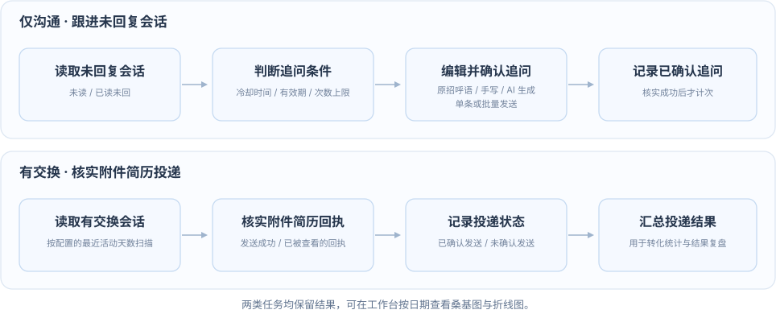

# Job Hunting Helper

<video controls playsinline preload="metadata" style="width: 100%; max-width: 960px;" aria-label="Job Hunting Helper 功能演示">
  <source src="docs/video-assets/job-hunting-helper.mp4" type="video/mp4">
  当前预览不支持视频播放，请使用下方链接打开。
</video>

[打开或下载演示视频](docs/video-assets/job-hunting-helper.mp4)

Job Hunting Helper 是面向 BOSS 直聘的本地求职助手，用 AI 和批量操作完成岗位采集、筛选、招呼与追问，并统计投递转化。

## 工作流程

项目围绕“找岗位 → 发招呼 → 跟进结果”运行：采集负责筛选岗位、发起沟通，监测负责追问、核实投递，两者结果汇总到工作台。

### 采集工作流


从推荐流或搜索流采集岗位，按求职条件预筛，再按需使用 AI 评分、生成招呼语，审核后批量发送。

### 监测工作流



招呼发出后，通过两类任务跟进沟通：

- **仅沟通**：跟进未读、已读未回会话，按规则准备追问，确认后批量发送。
- **有交换**：核实附件简历的发送或查看回执，记录已确认的投递结果。

## 安装

环境：Python 3、Node.js 20.19+ 或 22.12+、Google Chrome。以下以 macOS 为例。

```bash
git clone https://github.com/misakisaysyes/Job-Hunting-Helper.git
cd Job-Hunting-Helper
./web/start.sh
```

脚本会自动安装依赖并启动服务，保持终端运行即可。

## 使用

先在另一个终端启动调试模式的 Chrome，并在打开的窗口登录 BOSS 直聘：

```bash
open -na "Google Chrome" --args \
  --remote-debugging-port=9222 \
  --user-data-dir="$HOME/.job-hunting-helper-chrome"
```

保持浏览器运行，打开 <http://127.0.0.1:8000>，依次操作：

1. **配置**：设置求职条件；使用 AI 时配置模型、API Key 和 Markdown 简历，点击“生效配置”。
2. **采集**：启动采集，查看岗位与招呼语，审核后批量发送。
3. **监测**：扫描“仅沟通”和“有交换”，按需追问、核实投递。
4. **复盘**：在工作台选择日期，生成桑基图或折线图，查看转化情况。

## 配置与架构

展开查看完整说明，或单独打开 [Web 端配置](config.md) 与 [技术架构](tech.md)。

<details>
<summary>Web 端配置</summary>

<!-- BEGIN INLINE:config.md -->
在侧栏打开“配置”，依次设置岗位来源、筛选规则和处理方式，最后点击“生效配置”。

### 采集任务

| 采集方式 | 需要填写 |
| --- | --- |
| 推荐流 | 推荐流期望 ID，支持多个 |
| 搜索流 | 搜索关键词、城市和排序；城市留空时使用 BOSS 当前会话的城市 |
| 推荐流 + 搜索流 | 同时填写两类来源，每轮先推荐、再搜索 |

“每组最多页数”限制每轮每个期望 ID 或城市与关键词组合的页数。“本轮目标采集数”统计预筛通过的岗位；启用 AI 评分时，还须达到评分门槛。

### 反爬安全

| 配置 | 作用 |
| --- | --- |
| 每日访问额度 | 分别限制平台总页面、列表页和详情页的访问量 |
| 采集节奏 | 等待倍率越大，采集间隔越长；连续页面失败达到上限后停止本轮任务 |
| 风险暂停与锁定 | 设置风险触发后的随机暂停范围和平台锁定时长 |

### 岗位预筛与简历

- **岗位要求**：设置学历、经验、公司规模和招聘类型。同类选项满足任一项即可，留空表示不限；薪资单位为 K，边界填 0 表示不限。
- **排除条件**：按职位名、JD、公司名排除关键词，也可排除猎头岗位；英文匹配不区分大小写。
- **简历**：上传 UTF-8 编码的 `.md` 文件，不超过 1 MB，供 AI 评分和生成招呼语使用。

### AI 评分与招呼

| 配置 | 说明 |
| --- | --- |
| AI 评分 | 设置开关、评分门槛和补充要求；自动招呼只处理达到门槛的岗位 |
| 招呼语 | 可启用 AI 并补充提示词，或使用不超过 300 字的固定招呼语；模板留空时手动填写 |
| 模型服务 | 填写 OpenAI 兼容协议的服务商、模型、API 地址和 API Key，并选择思考模式 |
| 请求控制 | 设置超时、额外重试次数、重试等待范围和最大并发请求数 |

评分与招呼可独立开启。关闭 AI 评分后，预筛通过的岗位按 100 分处理，仍可生成招呼语。提示词留空时使用默认规则，招呼语发送前可编辑。

API Key 留空会保留已保存的密钥，页面只显示配置状态。“思考预算”为预留项，当前请求不提交该值。

### 监测任务

| 任务 | 配置与用途 |
| --- | --- |
| 已沟通（BOSS“仅沟通”） | 设置扫描最近活动天数、每条会话消息数；开启追问后，选择未读或已读未回，并设置有效期、冷却时长和最多追问次数 |
| 有交换 | 设置扫描最近活动天数，读取附件简历的发送或查看回执，用于核实投递结果 |

扫描范围按最近活动时间计算，追问有效期从会话首次入库起算。首次追问的冷却从招呼发送时间起算，后续从上次追问发送时间起算；准备好的追问可审核后批量发送。

### 运行配置

开启“静默后台运行”后，任务复用已登录 Chrome 的后台工作标签页，不切换当前页面，也不移动系统鼠标。主动点击“打开岗位/会话”仍会显示对应页面。

### 生效配置

点击“生效配置”会先保存修改，再应用到后续任务。若已有任务运行，修改仅保存，须在任务结束后再次点击；调整 AI 并发数时，页面会等待 API 自动重启。

配置保存在 `.state/user-config.json`，API Key 单独保存在 `.config.credentials.yaml`。
<!-- END INLINE:config.md -->

</details>

<details>
<summary>技术架构</summary>

<!-- BEGIN INLINE:tech.md -->
项目采用本地 Web 架构：React 提供操作界面，Python 执行采集、监测和 AI 任务，SQLite 保存结果；浏览器与模型服务分别负责访问 BOSS 直聘和生成内容。

### 整体结构

```text
React / Vite（工作台、采集、监测、配置）
                  │ /api
Python HTTP API（ThreadingHTTPServer）
                  │
采集 / 监测 / AI 调度
  ├─ Patchright + CDP → 已登录 Chrome → BOSS 直聘
  ├─ HTTPX → OpenAI 兼容模型服务
  └─ SQLite → 岗位、会话、回执、任务与统计
```

通过 `./web/start.sh` 启动时，前端默认使用 8000 端口，API 使用 8001 端口；Vite 将 `/api` 请求代理给后端。

### 模块分工

| 模块 | 主要位置 | 职责 |
| --- | --- | --- |
| Web 界面 | [web/src/features/](web/src/features/) | 展示任务、岗位、会话、配置与转化图表 |
| HTTP API | [api/](api/) | 校验请求、启动任务、返回状态和业务数据 |
| 采集流程 | [run.py](run.py)、[collector/](collector/) | 编排岗位获取、去重、预筛和 AI 处理 |
| 浏览器操作 | [browser/](browser/) | 通过 CDP 连接 Chrome，读取页面、发送招呼与追问 |
| AI 调用 | [ai/](ai/)、[score.py](score.py)、[message.py](message.py) | 共用模型客户端和线程池，执行评分、招呼与追问生成 |
| 数据与统计 | [data/](data/)、[api/conversion.py](api/conversion.py) | 保存岗位、会话及回执，聚合转化数据 |
| 配置与命令行 | [config.py](config.py)、[api/settings.py](api/settings.py)、[cli/](cli/) | 管理默认值、Web 配置和 CLI 入口 |

### 核心数据流

1. **采集**：推荐流或搜索流 → 去重、预筛 → 可选 AI 评分 → 准备招呼语 → 保存岗位 → 审核后批量发送。
2. **监测**：“仅沟通”读取会话、准备追问；“有交换”读取简历回执、确认投递。处理结果写入 SQLite。
3. **统计**：API 按日期聚合岗位、沟通与投递记录，前端绘制桑基图和趋势图。

### 任务与状态

- **后台执行**：采集、扫描和批量追问在后台线程运行，页面轮询进度；SQLite 任务记录限制这些任务同时运行。
- **AI 并发**：评分、招呼和追问共用 `AITaskScheduler` 线程池，由最大并发数约束模型请求。
- **状态恢复**：任务、草稿和发送结果持久保存；服务重启时将未完成任务标记为中断，无法确认的发送结果保留为未知状态。

### 配置与数据

| 文件或目录 | 内容 |
| --- | --- |
| `config.py` | 项目默认配置 |
| `.state/user-config.json` | Web 保存的配置，覆盖默认值；CLI 显式参数再覆盖本次采集配置 |
| `.config.credentials.yaml` | 本地 API Key，文件权限为 `0600`；无本地密钥时读取配置指定的环境变量 |
| `.state/resumes/` | Web 上传的 Markdown 简历 |
| `.state/boss-safety.sqlite3` | 默认 SQLite 数据库，保存岗位、会话、回执、任务及访问额度 |

Web 配置经校验后保存，点击“生效配置”应用；改变 AI 并发数时重启 API，以重新建立线程池。具体选项见 [Web 端配置](config.md)。
<!-- END INLINE:tech.md -->

</details>

## 许可

许可协议待补充。
